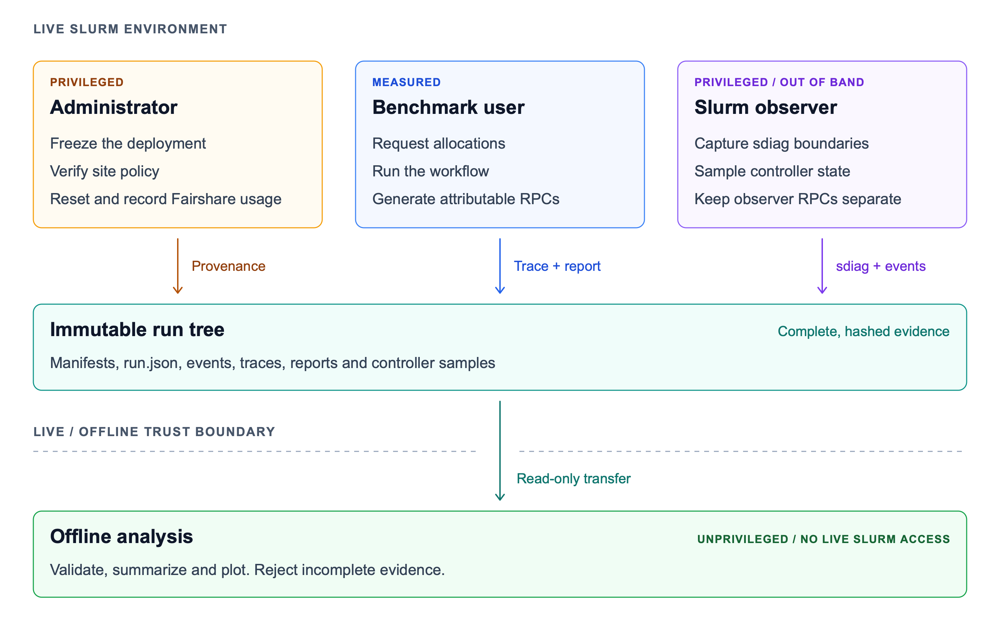

<p align="center">
  
</p>

<h1 align="center">WfTune</h1>

<p align="center">
  <strong>Measure workflow performance. Understand scheduler impact.</strong><br>
  Benchmark scientific workflow deployment on Slurm.
</p>

<p align="center">
  <a href="https://pypi.org/project/wftune/"></a>
  <a href="LICENSE"></a>
  <a href="https://arxiv.org/abs/2608.13824"></a>
  <a href="https://arxiv.org/abs/2608.13824"></a>
</p>

<p align="center">
  <a href="https://github.com/NilaBlueshirt/WfTune/wiki/Getting-Started">Get started</a> &middot;
  <a href="https://github.com/NilaBlueshirt/WfTune/wiki">Documentation</a> &middot;
  <a href="https://arxiv.org/abs/2608.13824">Read the paper</a>
</p>

---

> [!TIP]
> **Refactoring a WMS pipeline for Slurm?** The
> [`wms-hpc-refactor`](skill/wms-hpc-refactor/) agent skill guides a coding
> agent through refactoring, tuning, or reviewing a Nextflow, nf-core, or
> Snakemake pipeline for a shared Slurm cluster. It applies the ten practices
> from the USRSE'26 paper
> [*Ten Practices for Refactoring Scientific Pipelines to nf-core DSL2 on Shared Slurm HPC*](https://doi.org/10.5281/zenodo.22921770):
> it writes the change list before touching code, checks every change against
> the legacy pipeline's output, and leaves the changes uncommitted for human
> review.
>
> To use it with Claude Code, copy the folder into your skills directory:
>
> ```bash
> cp -r skill/wms-hpc-refactor ~/.claude/skills/
> ```

## Workflow speed is only half the picture

WfTune helps HPC teams compare how Nextflow and Snakemake workflows run on
Slurm. Measure completion time alongside scheduler demand to understand the
tradeoffs between deployment strategies on your own systems.

Reproducible collection and evidence audits support comparisons across
[workflow managers and backends](https://github.com/NilaBlueshirt/WfTune/wiki/Execution-Paths).
Every run also records the WfTune release that collected it, so results trace
back to an exact version of the tool.

## How it works

[](docs/images/wftune-trust-boundary.svg)

An administrator, the benchmark user, and an out-of-band Slurm observer each
write separate evidence to an immutable run tree. Analysis reads that evidence
offline, with no Slurm access, and rejects anything incomplete.

## Get started

- **Try it locally:** follow the [synthetic quick start](https://github.com/NilaBlueshirt/WfTune/wiki/Getting-Started), with no cluster required.
- **Benchmark your site:** use the [campaign guide](https://github.com/NilaBlueshirt/WfTune/wiki/Campaign-Guide) for collection and the [analysis guide](https://github.com/NilaBlueshirt/WfTune/wiki/Analysis) for results.

Full setup, methodology, and usage are in the
[wiki](https://github.com/NilaBlueshirt/WfTune/wiki).

## Research

The measurement methodology behind WfTune is described in a paper published at
the SC26 HPC Systems Professionals Workshop (HPCSYSPROS):

**[Balancing Workload Performance and Slurm Stress: Four Nextflow Deployment Strategies](https://arxiv.org/abs/2608.13824)**

[Read on arXiv](https://arxiv.org/abs/2608.13824) ·
[PDF](https://arxiv.org/pdf/2608.13824) ·
[Citation](https://github.com/NilaBlueshirt/WfTune/wiki/Citation)

---

[MIT License](LICENSE)
